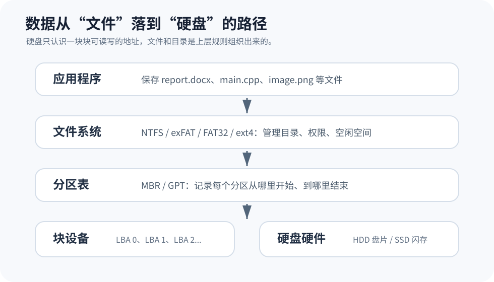
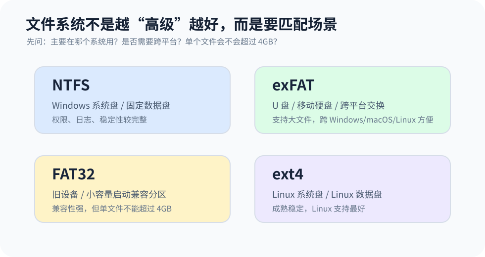
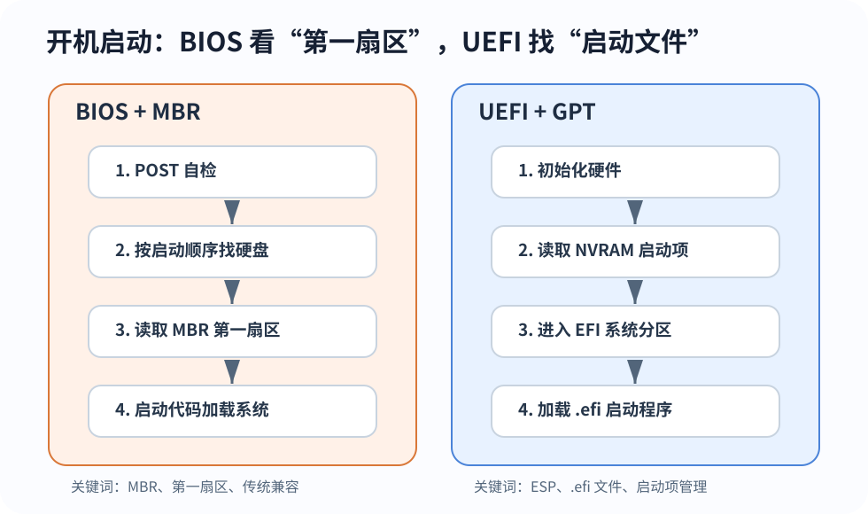

# 硬盘、分区、文件系统与启动方式：装系统前先搞清楚这几件事

很多人在第一次装系统、换 SSD、做双系统时，会被一串词劝退：

- MBR 和 GPT 选哪个？
- BIOS 和 UEFI 到底是什么？
- 为什么 Windows 安装器说“不能安装到这块磁盘”？
- EFI 系统分区能不能删？
- U 盘到底该格式化成 FAT32、exFAT 还是 NTFS？

这些词看起来像一堆互不相干的缩写，其实它们在回答同一个问题：**电脑开机之后，怎样从一块硬盘里找到操作系统，并把文件正常读出来？**

先给一个简单的总览：



可以把一块硬盘想成一栋还没有装修的大楼：

- **硬盘**提供原始空间，就像大楼本身；
- **分区表**决定这栋楼怎么划区域，哪里是系统区，哪里是数据区；
- **文件系统**决定每个区域里怎么摆文件、怎么记目录、怎么管权限；
- **BIOS/UEFI**负责开机时找到“启动入口”，把操作系统带起来。

这四层分清楚之后，再看 MBR、GPT、FAT32、NTFS、ESP 这些词，就不会乱成一团。

## 先从硬盘本身说起

我们平时说的硬盘，本质上是长期保存数据的存储设备。它和内存最大的区别是：内存断电就丢数据，硬盘断电后数据仍然保留。

常见硬盘大致可以从两个角度看。

按存储介质看：

| 类型 | 它怎么存数据 | 优点 | 缺点 |
| :-: | :- | :- | :- |
| HDD 机械硬盘 | 磁头在旋转盘片上读写 | 容量大、价格低 | 随机读写慢，怕震动 |
| SSD 固态硬盘 | 闪存芯片保存数据 | 随机读写快，抗震好 | 闪存有写入寿命，价格通常更高 |

按接口和协议看：

| 类型 | 常见外观 | 常见协议 | 你会感受到什么 |
| :-: | :- | :-: | :- |
| SATA HDD | 3.5 英寸或 2.5 英寸机械硬盘 | SATA/AHCI | 便宜大碗，但系统响应慢 |
| SATA SSD | 2.5 英寸 SSD 或 M.2 SATA | SATA/AHCI | 比机械硬盘快很多，但速度受 SATA 限制 |
| NVMe SSD | M.2 SSD | PCIe/NVMe | 延迟低、带宽高，现在的新电脑常见 |
| U 盘/移动硬盘 | USB 接口 | USB Mass Storage/UASP 等 | 方便移动，速度和稳定性差异很大 |

硬盘自己并不知道什么叫“桌面”“文档”“C 盘”“根目录”。从硬件角度看，它只是一长串可以读写的位置。操作系统会用 LBA（Logical Block Addressing，逻辑块寻址）给这些位置编号，然后在上面再组织出分区和文件。

也就是说，文件不是天然长在硬盘上的。文件是操作系统按照某种规则，在硬盘的一堆块里整理出来的结果。

## 分区表：先把硬盘切成几块

一块硬盘通常不会直接整块交给一个系统使用。我们会把它切成几个分区：

- Windows 里看到的 `C:`、`D:`；
- Linux 里看到的 `/dev/sda1`、`/dev/nvme0n1p2`；
- 装系统时看到的 EFI 分区、恢复分区、系统分区。

这些都是分区。

分区表就是硬盘上的一张“区域清单”。它记录每个分区从哪里开始、到哪里结束、是什么类型。操作系统先读分区表，知道“这块硬盘被分成了几段”，然后再进入某个分区去读文件系统。


现在最常见的分区表有两种：MBR 和 GPT。

## MBR：老方案，兼容性好，但限制多

MBR 的全称是 Master Boot Record，中文常叫主引导记录。它是比较早的分区表方案。

MBR 最大的特点是：很多关键东西都挤在硬盘最前面的第一个扇区里。这个地方既放一小段启动代码，也放分区表记录。

这套方案很经典，也很兼容老机器，但问题也明显：

- 标准 MBR 通常最多只能放 4 个主分区；
- 在传统 BIOS 启动的 Windows 场景下，单个分区通常受 2TB 上限影响；
- 分区信息集中在硬盘开头，那里坏了会比较麻烦；
- 它和传统 BIOS 启动方式绑定得比较紧。

所以 MBR 不是“不能用”，而是更适合旧电脑、旧系统、特殊兼容场景。新电脑上如果没有明确原因，一般不建议主动选它。

## GPT：新电脑的默认选择

GPT 的全称是 GUID Partition Table。它是现代电脑更常用的分区表方案，也通常和 UEFI 一起出现。

GPT 相比 MBR 更像一张更规范的地图：

- 支持更多分区；
- 支持更大的磁盘；
- 磁盘开头和末尾都会保存分区表相关信息，方便校验和恢复；
- 每个分区都有唯一标识，系统识别起来更稳定；
- 和 UEFI 启动配合更自然。

对于现在的新电脑、新 SSD、新系统，简单记住一句话就够了：

!!! tip "推荐选择"
    只要不是为了兼容很老的设备，装 Windows 或 Linux 时优先选择 **UEFI + GPT**。

## 文件系统：分区里面怎么放文件

分区只是划出了一块地方，但它还不能直接存成“文件夹”和“文件”。真正决定文件怎么命名、目录怎么组织、权限怎么记录、空闲空间怎么管理的，是文件系统。

所以装系统或格式化 U 盘时，你会看到 FAT32、exFAT、NTFS、ext4 这些选项。



### FAT32

FAT32 很老，但兼容性非常强。很多主板固件、相机、打印机、旧设备都认识它。

它的主要问题是功能弱，尤其是单个文件不能超过 4GB。今天随便一个系统镜像、视频素材、虚拟机镜像，都可能超过这个大小。

适合 FAT32 的场景：

- 小容量 U 盘；
- 需要兼容旧设备；
- UEFI 启动盘里的 EFI 系统分区；
- 某些设备明确要求 FAT32。

### exFAT

exFAT 可以理解成“更适合移动存储的现代 FAT”。它保留了 FAT 系列相对简单、容易被不同系统支持的特点，同时解决了 FAT32 单文件 4GB 的尴尬。

适合 exFAT 的场景：

- U 盘；
- 移动硬盘；
- 相机存储卡；
- Windows、macOS、Linux 之间交换大文件。

如果你只是想让一个移动硬盘在多台电脑之间传文件，exFAT 往往是最省心的选择。

### NTFS

NTFS 是 Windows 系统盘和固定数据盘最常见的选择。它支持权限、日志、压缩、加密等功能，比 FAT32/exFAT 更像一个完整的桌面操作系统文件系统。

适合 NTFS 的场景：

- Windows 系统盘；
- Windows 长期使用的固定硬盘；
- 需要权限管理、日志、加密、压缩等功能的分区。

不太适合的场景：

- 主要在 macOS 和 Windows 之间来回写入的移动盘；
- 很小、质量一般、频繁插拔的 U 盘。

这里要纠正一个常见说法：“U 盘用 NTFS 一定会伤盘”并不准确。更准确的说法是：NTFS 的日志和元数据写入可能比 exFAT 更频繁，小容量低质量 U 盘不一定划算；但真正影响寿命的仍然是闪存质量、写入量、主控和磨损均衡。

### ext4

ext4 是 Linux 上非常常见的文件系统。Ubuntu 等发行版安装时，如果没有特殊需求，根分区 `/` 选 ext4 是很稳妥的方案。

它适合：

- Linux 系统盘；
- Linux 数据盘；
- 服务器或开发环境里的普通本地磁盘。

它不适合：

- 拿去 Windows、macOS、Linux 三个平台之间直接交换文件。

不是 ext4 不好，而是 Windows 和 macOS 默认并不能像 Linux 一样自然读写 ext4。跨平台交换数据时，exFAT 通常更合适。

### 怎么选文件系统

| 场景 | 推荐文件系统 | 原因 |
| :- | :-: | :- |
| Windows 系统盘 | NTFS | Windows 原生支持完整，权限和日志功能完善 |
| Windows 固定数据盘 | NTFS | 稳定，功能完整 |
| Linux 系统盘 | ext4 | 成熟、稳定、工具完善 |
| U 盘/移动硬盘跨平台传文件 | exFAT | Windows、macOS、Linux 都比较方便 |
| 旧设备或兼容性优先 | FAT32 | 老设备识别率高 |
| UEFI 的 EFI 系统分区 | FAT32 | UEFI/Windows 部署规范通常要求这样做 |

## BIOS 和 UEFI：开机后第一个干活的人

硬盘里有系统，不代表电脑一通电就知道怎么运行它。

按下电源键后，CPU 先执行主板固件。固件会初始化硬件、做自检、选择启动设备，然后把控制权交给引导程序。这里的“固件”主要有两类：

- 传统 BIOS；
- 现代 UEFI。



## BIOS 启动：去硬盘最开头找入口

传统 BIOS 的思路比较直接：

1. 开机；
2. BIOS 做硬件自检；
3. 按启动顺序找到硬盘；
4. 读取硬盘最开头的 MBR；
5. 执行 MBR 里的启动代码；
6. 启动代码继续加载 GRUB、Windows Boot Manager 等引导程序；
7. 引导程序再加载操作系统内核。

可以把 BIOS 启动理解成：主板只知道“去硬盘第一页找入口”。问题是这一页很小，放不下复杂逻辑，所以它通常只负责把后面的引导程序接着拉起来。

这也是 BIOS 和 MBR 经常一起出现的原因。

## UEFI 启动：按启动项去找 .efi 文件

UEFI 的思路现代很多。它不再只盯着硬盘第一个扇区，而是可以读取一个专门的 EFI 系统分区，也就是 ESP（EFI System Partition）。

UEFI 启动大致是这样：

1. 开机；
2. UEFI 固件初始化硬件；
3. 固件读取 NVRAM 里的启动项，比如 `Windows Boot Manager` 或 `ubuntu`；
4. 根据启动项，到 EFI 系统分区里找到对应的 `.efi` 文件；
5. 加载这个 `.efi` 引导程序；
6. 引导程序再加载操作系统内核。

这就像主板有了一张“启动菜单”，菜单里写着要去哪个分区、哪个目录、哪个文件。

常见的 EFI 分区目录大概长这样：

```text
EFI/
├── Microsoft/
│   └── Boot/
│       └── bootmgfw.efi
├── ubuntu/
│   └── grubx64.efi
└── Boot/
    └── bootx64.efi
```

Windows 和 Ubuntu 可以共用同一个 EFI 系统分区，只是把各自的启动文件放在不同目录里。

!!! warning "不要随手删 ESP"
    EFI 系统分区通常不大，但它决定了系统能不能启动。除非你明确知道自己在修什么，否则不要随意格式化、删除或合并它。

## BIOS/UEFI 和 MBR/GPT 不是一回事

这是最容易混的一点。

BIOS/UEFI 说的是：**主板固件用什么方式启动电脑。**

MBR/GPT 说的是：**硬盘用什么方式记录分区。**

它们不是同一层东西，只是经常成对出现：

| 常见搭配 | 启动方式 | 分区表 | 常见场景 |
| :-: | :- | :- | :- |
| BIOS + MBR | 从硬盘开头的 MBR 启动 | MBR | 老电脑、老系统、兼容模式 |
| UEFI + GPT | 从 EFI 系统分区加载 `.efi` 文件 | GPT | 新电脑、新系统、主流推荐 |

实际装系统时，同一个启动 U 盘可能在启动菜单里出现两项：

```text
UEFI: USB Disk
USB Disk
```

如果你想安装成 UEFI + GPT，应该选带 `UEFI:` 前缀的那一项。否则安装器可能以传统 BIOS 兼容模式启动，后面就会遇到“当前启动方式”和“目标磁盘分区表”不匹配的问题。

Windows 安装器里常见的报错：

```text
Windows cannot be installed to this disk.
The selected disk is not of the GPT partition style.
```

这句话的核心意思通常是：你现在是用 UEFI 模式启动安装器的，但目标磁盘不是 GPT 分区表。

解决思路不是盲目乱删分区，而是先确认三件事：

1. 你是用 UEFI 还是 Legacy BIOS 模式启动安装 U 盘；
2. 目标磁盘是 GPT 还是 MBR；
3. 你到底想保留数据转换，还是清空磁盘重新分区。

## 装系统时怎么选

如果只是普通新电脑安装 Windows 或 Linux，建议按下面来：

| 需求 | 推荐 |
| :- | :- |
| 新电脑装 Windows | UEFI + GPT + NTFS |
| 新电脑装 Ubuntu/Linux | UEFI + GPT + ext4 |
| Windows/Linux 双系统 | UEFI + GPT，保留 EFI 系统分区 |
| 2TB 以上硬盘 | GPT |
| 老电脑、老系统兼容 | 可能需要 BIOS + MBR |
| 移动硬盘跨平台传文件 | exFAT |

几个实用提醒：

- 安装系统前，先备份重要数据；
- 不确定时，不要轻易点“删除所有分区”；
- 多系统共存时，重点保护 EFI 系统分区；
- 想装成 UEFI + GPT，就从启动菜单里选择 `UEFI:` 开头的 U 盘；
- 如果已经装好了系统，后续再改 BIOS/UEFI 或 MBR/GPT，可能会导致无法启动。

## 排错时按层次查

启动问题不要一上来就判断“系统坏了”。可以按下面顺序查：

1. **硬件层**：主板能不能识别到 SSD/HDD？线有没有松？硬盘有没有掉盘？
2. **固件层**：启动顺序对不对？当前是 UEFI 还是 Legacy BIOS？Secure Boot 是否影响第三方引导？
3. **分区表层**：磁盘是 MBR 还是 GPT？和当前启动方式是否匹配？
4. **启动分区层**：EFI 系统分区是否存在？里面有没有对应的 `.efi` 文件？
5. **引导程序层**：Windows Boot Manager、GRUB、systemd-boot 是否还在？
6. **文件系统层**：系统分区是否损坏？是否需要文件系统检查？

这样排查会比“看见报错就重装系统”靠谱得多。

举两个例子：

- 电脑提示找不到系统，可能只是启动顺序错了，也可能是 EFI 分区损坏；
- Windows 安装器不让你装到某块盘，可能不是硬盘坏了，而是 UEFI/BIOS 启动模式和 GPT/MBR 分区表不匹配。

## 最后总结

把这几个概念压缩成一句话：

> 硬盘提供空间，分区表负责划区域，文件系统负责管理文件，BIOS/UEFI 负责开机时找到引导程序。

如果你只是想在新电脑上装系统，优先记住：

- 系统启动方式：UEFI；
- 磁盘分区表：GPT；
- Windows 系统盘：NTFS；
- Linux 系统盘：ext4；
- 跨平台移动盘：exFAT；
- EFI 系统分区：不要乱删。

理解这条链路之后，装系统、分区、修启动时看到的那些缩写，就不再是孤立的名词，而是一套能连起来的流程。

## 参考资料

- [Microsoft Learn：基于 UEFI/GPT 的硬盘驱动器分区](https://learn.microsoft.com/zh-cn/windows-hardware/manufacture/desktop/configure-uefigpt-based-hard-drive-partitions?view=windows-11)
- [Microsoft Learn：基于 BIOS/MBR 的硬盘驱动器分区](https://learn.microsoft.com/zh-cn/windows-hardware/manufacture/desktop/configure-biosmbr-based-hard-drive-partitions?view=windows-11)
- [Microsoft Learn：Windows 安装程序使用 MBR 或 GPT 分区样式进行安装](https://learn.microsoft.com/en-us/windows-hardware/manufacture/desktop/windows-setup-installing-using-the-mbr-or-gpt-partition-style?view=windows-11)
- [UEFI Specification 2.10：Boot Manager](https://uefi.org/specs/UEFI/2.10/03_Boot_Manager.html)
- [Microsoft Learn：File System Functionality Comparison](https://learn.microsoft.com/en-us/windows/win32/fileio/filesystem-functionality-comparison)
- [Microsoft Learn：exFAT File System Specification](https://learn.microsoft.com/en-us/windows/win32/fileio/exfat-specification)
- [Linux Kernel Documentation：ext4 Journal](https://docs.kernel.org/filesystems/ext4/journal.html)
